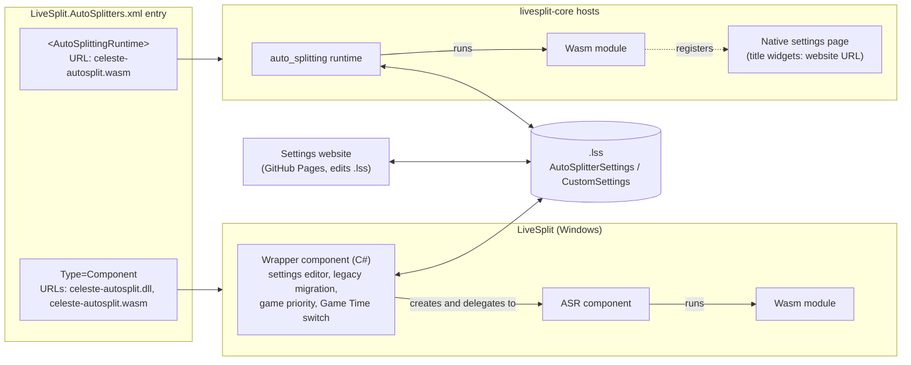

# Celeste Auto Splitter: Cross-Platform Architecture Spec

This document is not to be cited.

---

## 1. Summary

A single **WebAssembly auto splitter** (`celeste-autosplit.wasm`) is the only splitting engine on every host. All of its configuration lives in the **ASR settings map**. Every host already saves that map into the `.lss` splits file, so settings travel with the splits between hosts.

The native ASR settings widgets are too limited, so each host family gets its own **settings editor** that only reads and writes that map:

- **LiveSplit (Windows):** a C# component DLL (`celeste-autosplit.dll`). It wraps the wasm module, delegates all auto splitting to LiveSplit's Auto Splitting Runtime (ASR) component, and replaces the settings UI with its own control.
- **livesplit-core hosts:** a GitHub Pages website that edits the settings inside a `.lss` file. The wasm module's native settings page shows only a text pointer to that website.

A single entry in `LiveSplit.AutoSplitters.xml` serves both host families. LiveSplit desktop reads the top-level `Type=Component` part (DLL plus wasm). livesplit-core reads the nested `<AutoSplittingRuntime>` part (wasm only).

On Windows, the component also **migrates existing `LiveSplit.Celeste` settings** into the new map. Legacy settings exist only on Windows, so no other host needs a migration.

---

## 2. Goals and non-goals

**Goals**

1. One implementation of the splitting logic (the wasm module), identical on every host.
2. A rich settings editor that isn't limited by the ASR widget set (bool, title, choice, file-select).
3. Settings that move between hosts through the `.lss` file.
4. A smooth upgrade for existing `LiveSplit.Celeste` users on Windows, including their settings.
5. Distribution through the official auto splitter list, with automatic download on every host that reads it.

**Non-goals**

- Native settings editors inside livesplit-core hosts. The website covers these for now.
- Migrating legacy settings on non-Windows hosts, which have no prior standard. The website's legacy import covers runners moving old `.lss` files to other hosts (§8).
- Downgrading from the new component back to the legacy component.
- 32-bit Windows. ASR only runs wasm modules in 64-bit processes (§7.5), so 32-bit users have to keep using the legacy component.
- Any change to LiveSplit, livesplit-core, ASR or the list format.

---

## 3. Terminology

| Term | Meaning |
|---|---|
| **Host** | Any LiveSplit flavour that runs the wasm module. |
| **Wasm module** | `celeste-autosplit.wasm`, the Celeste auto splitter compiled to WebAssembly against the `asr` crate. |
| **Settings map** | The ASR runtime's key/value store, which supports map, list, bool, i64, f64 and string. Hosts persist it in the `.lss`. |
| **`cfg`** | The single top-level map key that holds all real settings (§5). |
| **Wrapper component** | `celeste-autosplit.dll`, the new C# component for LiveSplit desktop. |
| **ASR component** | `LiveSplit.AutoSplittingRuntime.dll`'s `ASRComponent`, which ships with LiveSplit and runs wasm modules. |
| **Legacy component** | The existing `LiveSplit.Celeste.dll` by DevilSquirrel (ShootMe). |
| **The list** | `LiveSplit.AutoSplitters.xml` in the LiveSplit/LiveSplit.AutoSplitters repo. |

---

## 4. System overview



### Responsibilities

| Concern | Wasm module | Wrapper component (Windows) | Website | Host |
|---|---|---|---|---|
| Attach to game, read memory | ✅ | | | |
| Start, split, reset, game time | ✅ | | | |
| Define the settings schema | ✅ (source of truth) | consumes it | consumes it | |
| Validate settings, apply defaults | ✅ | | | |
| Schema migrations (`schema_version`) | ✅ | | | |
| Rich settings editing | | ✅ | ✅ | |
| Native fallback UI (website pointer) | ✅ | | | renders it |
| Legacy `LiveSplit.Celeste` migration | | ✅ | legacy import | |
| Game process priority, Game Time switch | | ✅ (§7.7, §7.8) | | |
| Persist the settings map in `.lss` | | via the ASR component | writes the file directly | ✅ |
| Download and update files | | own update XML | | list, updater |

**Rule:** editors only edit data, and no splitting behaviour lives outside the wasm module. The only exceptions are the Windows-only game process priority (§7.7) and the switch to Game Time (§7.8). Neither affects start, split, reset or timing decisions.

---

## 5. Settings contract

### 5.1 Persistence

Every host stores the settings map in the `.lss` inside `<AutoSplitterSettings>`:

```xml
<AutoSplitterSettings>
  <Version>1.0</Version>
  <CustomSettings>
    <Setting id="schema_version" type="i64">1</Setting>
    <Setting id="cfg" type="map">
      <Setting id="auto_reset" type="bool">True</Setting>
      <Setting id="splits" type="list">
        <Setting type="map">
          <Setting id="kind" type="string" value="chapter_complete" />
          <Setting id="chapter" type="i64">1</Setting>
        </Setting>
      </Setting>
    </Setting>
  </CustomSettings>
</AutoSplitterSettings>
```

- **Who writes it:** the C# ASR component (`ComponentSettings.GetSettings`) and livesplit-core (`StoredAutoSplitterSettings`) use the same format. On Windows the wrapper creates the ASR component with a fixed script path, so no `<ScriptPath>` is written. livesplit-core hosts ignore `ScriptPath` anyway.
- **Keys without widgets survive:** both implementations save the **entire** map, not just the keys that have widgets. So data written by the editors survives a load and save on any host.
- **Serialisation rules:**
  - `bool`, `i64` and `f64` values go in the element text, using invariant culture (`True`/`False` for bools).
  - `string` values go in a `value` attribute.
  - Maps and lists nest `<Setting>` children. List items have no `id`.
- **Key order is preserved:** maps keep insertion order, so parsing and re-writing a map gives byte-identical XML, including escaped strings and empty maps and lists (verified against the C# ASR component).
- **The parser is strict:** if any element in `CustomSettings` fails to parse, the C# ASR component discards the **whole** map. Generated XML must be exact (see §13 round-trip tests).

### 5.2 Top-level keys

| Key | Type | Written by | Purpose |
|---|---|---|---|
| `schema_version` | i64 | editors; the wasm module when migrating | Version of the `cfg` layout. |
| `cfg` | map | editors | All real settings. |
| `legacy` | map | wrapper (during migration) | Verbatim copy of the old `LiveSplit.Celeste` settings, kept for re-migration and debugging. |
| `_ui_*` | — (title widget keys) | wasm module | Reserved for native fallback widgets. Title widgets hold no value. Never use for data. |

Widget keys and map keys share one namespace, which is why the `_ui_` prefix is reserved.

### 5.3 `cfg` schema (version 1)

```text
cfg: map
  start:          trigger        default {kind: "manual"}
  splits:         list<trigger>  default []
  timing_method:  string         default "file"
                  "file" | "chapter" | "file_since_start" | "chapter_since_start"
  reset:          string         default "never"
                  "never" | "leave_chapter"
  everest:        bool           default false
  high_priority:  bool           default true    LiveSplit (Windows) only (§7.7)
  set_game_time:  bool           default true    LiveSplit (Windows) only (§7.8)
```

| Key | Meaning |
|---|---|
| `start` | The trigger that starts the timer. |
| `splits` | `splits[i]` is the trigger that ends segment `i`. Bound by position to the timer's current split index (`asr::timer::current_split_index`, supported by ASR 0.0.12), so manual splits, skips and undos keep it aligned. Segments past the end of the list are split by hand. Extra entries are ignored. |
| `timing_method` | Which game time the module reports. `file` is the save file's time. `chapter` is the chapter time, held while outside a chapter so a save and quit doesn't drop it to zero. `*_since_start` subtracts the value at the moment the start trigger fired. |
| `reset` | `leave_chapter` resets the timer whenever the game is outside a chapter (return to map, save and quit, restart), **including after the run has ended**. That reset is how an IL attempt is committed. |
| `everest` | Turns on the Everest-only fields (rule 9). |
| `high_priority` | The wrapper sets the Celeste process's priority. |
| `set_game_time` | The wrapper switches LiveSplit's timing method to Game Time. |

**An empty `cfg` does nothing.** It has no automatic start, reset or splits; the module only reports game time.

Editors offer **presets** that set `start`, `timing_method`, `reset` and the `timing` of every `chapter_complete` split together:

| Preset | `start` | `timing_method` | `reset` | `chapter_complete` `timing` |
|---|---|---|---|---|
| Full game | `new_file` | `file` | `never` | `chapter_exit` |
| Individual level | `chapter_start` | `chapter` | `leave_chapter` | `chapter_complete` |

Presets exist only in the UI and nothing about them is stored. A configuration that matches no preset is shown as "Custom".

#### Triggers

A trigger is a map with a `kind` and kind-specific fields. Every kind is valid in both `start` and `splits`. `sid` is accepted wherever `chapter` is, except on `checkpoint`, whose rooms are only known for vanilla chapters (rule 9).

| `kind` | Required | Optional | Fires when |
|---|---|---|---|
| `manual` | — | — | never |
| `unknown` | `raw` | — | never. Produced only by migration, and flagged by editors. |
| `new_file` | — | — | a new save file is started |
| `chapter_start` | — | `chapter`, `side` | the chapter timer starts (`ChapterStarted` rises) |
| `chapter_enter` | `chapter` | `side` | the chapter ID changes to `chapter` |
| `chapter_exit` | `chapter` | `side` | the chapter ID changes from `chapter` |
| `chapter_complete` | — | `chapter`, `side`, `timing` | the chapter is completed (`timing: "chapter_complete"`, the default), or the game leaves the completed chapter (`timing: "chapter_exit"`) |
| `checkpoint` | `chapter`, `checkpoint` | `side` | the checkpoint's room is entered |
| `heart` | — | `chapter`, `side` | a crystal heart is collected |
| `cassette` | — | `chapter`, `side` | a cassette is collected |
| `room_enter` | `room` | `chapter`, `side` | the room changes to `room` |
| `room_exit` | `room` | `chapter`, `side` | the room changes from `room` |

#### Fields

| Field | Type | Values |
|---|---|---|
| `kind` | string | the table above |
| `chapter` | i64 | The game's chapter ID, as the memory reader reports it, not the chapter number (table below). Higher IDs are modded chapters. `-1` means "not in a chapter", which is only meaningful for `chapter_enter` and `chapter_exit`. |
| `side` | i64 | The game's side value: `0` = A, `1` = B, `2` = C |
| `timing` | string | `"chapter_complete"` or `"chapter_exit"`, only on `chapter_complete` |
| `checkpoint` | i64 | 1-based checkpoint number within the chapter (chapter data below) |
| `room` | string | Room name exactly as the game reports it, matched case-sensitively |
| `sid` | string | Everest only. A chapter's SID, for example `Celeste/1-ForsakenCity` |
| `raw` | string | The original legacy `Type[,Value]` text |

| ID | Chapter | | ID | Chapter |
|---|---|---|---|---|
| 0 | Prologue | | 6 | Reflection |
| 1 | Forsaken City | | 7 | The Summit |
| 2 | Old Site | | 8 | Epilogue |
| 3 | Celestial Resort | | 9 | **Core** (Chapter 8) |
| 4 | Golden Ridge | | 10 | **Farewell** (Chapter 9) |
| 5 | Mirror Temple | | | |

#### Chapter data

`checkpoint` triggers fire on entering a room that depends on the side being played. The names and rooms for every vanilla checkpoint live in the `chapters` section of `schema/settings-schema.json`, taken from the legacy component.

C-sides have no checkpoints, but legacy also checks the B-side rooms on C-sides, so the C-side entries repeat B for parity.

### 5.4 Rules

1. **Missing key means default.** The wasm module never requires a key to be present. `gui::add_bool` returns a default without writing it into the map, so the map only ever holds values someone explicitly set.
2. **Additive changes** don't bump `schema_version`. These are a new optional key with a default, a new trigger kind, or a new optional field. Renames, removals and changes of meaning do bump it.
3. **Editors preserve unknown keys** inside `cfg`, including inside trigger maps, so an older editor doesn't delete newer settings.
4. **Editors refuse newer schemas.** If `schema_version` is higher than an editor understands, it opens read-only and tells the user to update.
5. **One schema definition.** `schema/settings-schema.json` describes the keys, trigger kinds, fields, presets and chapter data. It ships with each release.
   - The C# editor and the website render from it.
   - The wasm module generates its settings types and checkpoint rooms from it at build time.
   - Field lists and room tables are never maintained by hand in three places.
   - It's plain JSON with its own vocabulary rather than JSON Schema. The format is documented in `schema/README.md`.
6. **Writing from the wasm module** (only for schema migrations) uses `Map::store_if_unchanged` and retries on `false`, never `Map::store`.
7. **Host-specific keys** (`high_priority`, `set_game_time`) are ignored by the wasm module. The website shows them labelled "LiveSplit (Windows) only".
8. **Triggers:**
   - An absent optional field matches anything, so `{kind: "heart"}` is any heart.
   - An invalid trigger behaves like `manual`. That covers a missing required field, a wrong type, an out-of-range value and an unknown `kind`, so an older module treats a newer kind as `manual`. The module logs the problem, and editors flag the entry.
9. **Everest-only fields** count only when `everest` is `true`. Otherwise the module ignores them as if absent, and editors hide them but keep them.
   - **v1 has one such field: `sid`.** It's accepted wherever `chapter` is, except on `checkpoint`. When present and `everest` is on, it replaces `chapter`. The reason is that Everest assigns modded chapter IDs at load time, so they change when the installed mods change, while SIDs don't.
   - **If the game isn't running Everest,** the module can't evaluate these fields. It logs that, and the affected triggers don't fire.
   - **Later candidates**, each additive: a level set filter, and a "golden grabbed" trigger from Everest's chapter flags.

---

## 6. Wasm module

### 6.1 Responsibilities

Everything that affects timing:
- process attach and memory reading;
- start, split, reset and game time;
- interpreting `cfg`, applying defaults and validating values;
- migrating older `schema_version` values.

### 6.2 Native fallback UI

The module registers **title widgets only**. These are plain text, not clickable, and write nothing into the map:

```rust
use asr::settings::gui;

const URL: &str = "<owner>.github.io/<repo>";

fn register_native_ui() {
    gui::add_title("_ui_heading", "Configure this auto splitter at:", 0);
    gui::add_title("_ui_url", URL, 1);
    gui::set_tooltip("_ui_url", "Open in a browser, load your .lss, edit, save, then reload the splits.");
}
```

- On Windows these widgets are never shown, because the wrapper supplies its own settings control.
- AlexKnauth's Druid fork renders `Title`, `Bool`, `Choice` and `FileSelect` widgets, so the text appears there.
- The LiveSplit One desktop MVP has no settings UI, so nothing shows there.
- **Do not use `gui::add_text_input`.** It exists in the `asr` crate, but the C# ASR component only renders `bool`, `title`, `choice` and `file-select`.
- Keep the URL short and easy to type.

### 6.3 Reading settings

- **The module starts before its settings arrive.** On Windows the ASR component starts the runtime in its constructor with an empty map, and the real map is applied moments later by `SetSettings`. The module must therefore never read settings only once at startup.
- `Map::load()` returns a snapshot.
- Re-read the snapshot periodically (for example once a second, and on timer reset) and re-parse `cfg` only when it has changed.
- Parse defensively: wrong types or out-of-range values fall back to defaults and are logged.

### 6.4 Portability

Use only `asr` crate APIs available in every host's runtime. Assume nothing host-specific.

### 6.5 Trigger behaviour

These rules for implementing the §5.3 triggers keep parity with the legacy component (§11.1). None of them is a user choice, so none has a setting.

- **`chapter_complete`** works in two phases:
  - It arms on the rising edge of `ChapterComplete` in the matching chapter.
  - With `timing: "chapter_complete"` it fires as soon as it arms. With `timing: "chapter_exit"` it fires when `ChapterComplete` falls again, in any chapter. That's the flag falling, not the chapter ID changing as for the `chapter_exit` kind. The two may land on different frames, so keep the legacy signal.
  - For chapter 7, it only arms when the current room doesn't start with `credits`. Legacy skips this check for "any chapter" (no `chapter` filter); keep that.
  - Side matching uses the side from the previous tick, as legacy does.
- **`heart` and `cassette`** fire on the rising edge of the chapter's heart or cassette flag, in every setup.
  - Legacy also split when the file's total count went up by one, and used the flag only in IL and file-time-offset setups.
  - Counting breaks ILs on a file that already has the heart. Reacting to the flag while it stays set double-splits consecutive heart splits. The rising edge avoids both.
- **`checkpoint`** fires on entering the room, including spawning into it from the menu. Legacy fired whenever the current room matched. The two only differ when the previous split fired in that same room.
- **`chapter_start`** ignores the first 3 s after attaching, as legacy does.
- **`chapter_enter` and `chapter_exit` with a `side`** require the side to change too, as legacy does.
- **`room_enter` and `room_exit`** fire only inside a chapter.
- **Game time** is paused whenever its value doesn't change.

---

## 7. Wrapper component (LiveSplit, Windows)

### 7.1 Build and packaging

- **Project type:** .NET Framework class library targeting `net4.8.1`, the same as LiveSplit.Core and the ASR component.
- **Output names:**
  - `AssemblyName`: `celeste-autosplit`, which produces `celeste-autosplit.dll`.
  - `RootNamespace`: `CelesteAutosplit`, because hyphens aren't valid in C# namespaces.
  - **Why the assembly name matters:** it differs from the legacy `LiveSplit.Celeste` assembly, which is required. LiveSplit loads every DLL in `Components\` with `Assembly.UnsafeLoadFrom`, and two assemblies with the same identity can resolve to whichever was loaded first.
- **References:** both `LiveSplit.Core` and `LiveSplit.AutoSplittingRuntime` are compile-time references, neither copied to the output.
  - **Configuration:** `Private="false"`, plus `ExcludeAssets="runtime"` for project references. This is the same pattern the ASR project uses for LiveSplit.Core.
  - **Never ship `LiveSplit.AutoSplittingRuntime.dll`.** The copy in `Components\` belongs to LiveSplit.
  - **Source:** ASR isn't on NuGet. Reference it from a LiveSplit build or install, or add LiveSplit and LiveSplit.AutoSplittingRuntime as git submodules.
  - **Why it binds at runtime:**
    - LiveSplit loads component DLLs with `Assembly.UnsafeLoadFrom`, and .NET Framework resolves their dependencies from the folder they were loaded from.
    - The wrapper and `LiveSplit.AutoSplittingRuntime.dll` both live in `Components\`, so the reference resolves to the ASR assembly LiveSplit already loaded.
    - ASR is not strong-named, so binding is by name only, and a newer ASR shipped with LiveSplit still binds. Its assembly identity is `LiveSplit.AutoSplittingRuntime, Version=1.0.0.0, PublicKeyToken=null`; `0.0.x` is only its factory's `Version`.
- **Factory attribute:** `[assembly: ComponentFactory(typeof(CelesteAutosplitFactory))]`.

### 7.2 Factory (`IComponentFactory` / `IUpdateable`)

| Member | Value |
|---|---|
| `ComponentName` | Celeste Autosplitter |
| `Category` | `Control`. The category doesn't affect visibility. LiveSplit's layout editor (`LayoutEditorDialog.LoadAllComponentsAvailable`) leaves out any component factory whose DLL is the first URL of an auto splitter list entry without `<ShowInLayoutEditor/>`. `celeste-autosplit.dll` is that first URL (§10.1), so users can't add the wrapper to a layout and it only runs as the auto splitter. |
| `Create(state)` | returns a new wrapper |
| `UpdateName`, `Version` | from the assembly version, which must match the latest version in `update.xml` (§10.4) |
| `XMLURL`, `UpdateURL` | see §10.4 |

### 7.3 Wrapper component (`LogicComponent`)

| Member | Behaviour |
|---|---|
| Constructor | Resolve `wasmPath = Path.GetFullPath(Path.Combine(ComponentManager.BasePath ?? "", "Components", "celeste-autosplit.wasm"))`. If LiveSplit runs as a 32-bit process or the wasm is missing, enter the error state (§7.5). Otherwise create the inner component in a try/catch: `inner = new ASRComponent(state, wasmPath)`, the same constructor `ASRFactory.Create(state, script)` uses. Then check that ASR actually loaded the module (§7.6). If it didn't, dispose `inner` and enter the error state. Then run the layout check (§11.6). |
| `Update(...)` | Forward to `inner.Update(...)`. LiveSplit calls this on the active auto splitter every frame. The ASR component's `Update` is currently empty: it steps the runtime on its own timer, marshalled to the UI thread through `state.Form`. The timer starts at 15 ms and then follows the module's tick rate (8.33 ms for the `asr` crate's default 120 Hz). Forwarding keeps the wrapper correct if a future ASR does work there. Also drives the throttled priority check (§7.7). |
| `GetSettings(doc)` | `inner.GetSettings(doc)`, unchanged. This is what `XMLRunSaver` writes into the `.lss`. In the error state, return the held settings (§7.5). |
| `SetSettings(node)` | If the node is in the legacy format, migrate it (§11). Then call `inner.SetSettings(node)` and refresh the wrapper's cached `cfg.high_priority`. On the first call, apply `cfg.set_game_time` (§7.8). **Never** pass legacy XML through: the ASR component replaces the map with an empty one (verified). ASR ignores an empty element (`<AutoSplitterSettings/>`) and keeps its current map. In the error state, hold a copy of the node (§7.5). |
| `GetSettingsControl(mode)` | The wrapper's own editor control. Must not be null, or LiveSplit disables the Settings button. |
| `Dispose()` | Restore the game's priority if the wrapper raised it (§7.7). Then `inner.Dispose()`, which stops its update timer and disposes the runtime. **Required.** LiveSplit calls `Dispose` on deactivation or a game change. Without forwarding it, the inner timer keeps running and the old module keeps controlling the timer. |
| `ContextMenuControls` | Optional: forward `inner.ContextMenuControls`. LiveSplit adds the active auto splitter's entries to its Control menu. ASR currently provides none. |

### 7.4 Editor control

**Data path: an XML round-trip through public API.**

1. When the editor opens, call `inner.GetSettings(doc)`, parse `CustomSettings` into the editor model, and render it from the shared schema.
2. On **every** change, serialise the model to the §5.1 format and call `inner.SetSettings(node)`.

Changes must reach `inner` straight away because of how LiveSplit's `ComponentSettingsDialog` works:
- when it opens, it snapshots `GetSettings()`;
- on **OK**, the splits editor reads `GetSettings()` again and stores the result as `Run.AutoSplitterSettings`;
- on **Cancel**, it calls `SetSettings(snapshot)` to undo.

So `GetSettings`/`SetSettings` must round-trip losslessly.

**Concurrency:** the wasm module only writes during schema migration. The editor re-reads `inner.GetSettings` each time it opens, so a migration that ran earlier is picked up.

### 7.5 Error handling

- LiveSplit reports activation failures only as a generic "could not be activated" message. The wrapper logs details itself and shows the cause inside its editor control.
- **Failures the wrapper detects:**

  | Failure | Detected by | Typical cause |
  |---|---|---|
  | 32-bit process | `Environment.Is64BitProcess`, checked first | 32-bit Windows |
  | Wasm missing | `File.Exists(wasmPath)` before creating the ASR component | Incomplete download (see below) |
  | ASR component can't be created | An exception from `new ASRComponent(...)`: `FileNotFoundException`, `MissingMethodException` or `TypeLoadException` | No ASR in this LiveSplit, or its API changed (§7.6) |
  | ASR can't run the module | `ComponentSettings.runtime` is null after construction (§7.6) | A corrupt wasm, or a module using wasm features or `asr` functions the bundled ASR doesn't support |

- **ASR doesn't fail on 32-bit, so the wrapper checks first.** There is no separate 32-bit LiveSplit: every release is one zip, and `LiveSplit.exe` runs as a 32-bit process only on 32-bit Windows.
  - ASR's 32-bit native library is a stub. Creating a runtime succeeds with a dummy, stepping does nothing, and every settings map is empty.
  - Without the check, the wrapper would report "Running" while nothing runs, and `GetSettings` would return an empty `CustomSettings`. Saving the splits would then wipe the user's settings.
  - The wrapper's status reads: "This autosplitter requires 64-bit Windows. If you need a 32-bit version, download the legacy LiveSplit.Celeste component and add it to your layout."
- **ASR hides load failures.** `ComponentSettings.ReloadRuntime` catches the load exception, logs it and leaves `runtime` null, so `new ASRComponent(...)` succeeds with nothing running. Without the check, the wrapper would look active and never split.
- **Error state:** in all these cases the wrapper has no inner component. `Update` and `Dispose` do nothing. `SetSettings` keeps a copy of the node and `GetSettings` returns it unchanged. This matters because an ASR component without a runtime discards `SetSettings` and writes an empty `CustomSettings`, which LiveSplit would save into the `.lss`, wiping the user's settings.
- **Where details go:** LiveSplit's `Log` writes through `System.Diagnostics.Trace`. Only warnings and errors reach the Windows Event Log, and only if the `LiveSplit` event source exists (creating it needs admin once). Info messages go only to the debug output, which Sysinternals DebugView shows. That includes everything the wasm module prints and ASR's explanation of why a module failed to load.
- **Missing wasm:** LiveSplit checks only that the **first** URL in the list entry (the DLL) exists, so a missing wasm is never re-downloaded by LiveSplit. The wrapper either shows a repair message or downloads `celeste-autosplit.wasm` itself from `https://github.com/<owner>/<repo>/releases/latest/download/celeste-autosplit.wasm`.

### 7.6 Dependency on ASR internals

The wrapper depends on three things owned by `LiveSplit.AutoSplittingRuntime`, none of which is a stable API:
- the `ASRComponent(state, scriptPath)` constructor;
- the `CustomSettings` XML format;
- `ComponentSettings.runtime`, a public field reached by casting `inner.GetSettingsControl(...)` to `ComponentSettings`. It's the only way to tell whether ASR loaded the module (§7.5).

**Keep ASR types out of the factory.** `CelesteAutosplitFactory` must not use ASR types in its fields, properties or method signatures. LiveSplit creates factories inside `ComponentManager.LoadFactory`, which swallows every exception with `catch { }`. If creating the factory pulls in ASR types and that fails, the factory silently becomes `null` and users see only "could not be activated". Use ASR types only inside the wrapper component.

**Confine ASR types to two out-of-line methods.** The JIT resolves the types a method uses when it compiles that method, before any of it runs. If the wrapper's constructor used `ASRComponent` directly, a missing or changed ASR would throw while the constructor was being compiled. The exception would surface in the caller (`Create`), outside the constructor's try/catch. Therefore:
- The inner component's field is typed `LogicComponent`, from LiveSplit.Core. All forwarding goes through `LogicComponent`'s abstract members.
- Only two methods use ASR types: one calls the constructor, the other reads `ComponentSettings.runtime`. Both are marked `[MethodImpl(MethodImplOptions.NoInlining)]` and called inside a try/catch.
- If a future ASR removes or changes one of these members, the call fails at runtime with `MissingMethodException`, `MissingFieldException` or `TypeLoadException`, and the wrapper enters the error state (§7.5). The compile-time reference only protects against mismatches with the ASR version you build with.

**Track the tested version.**
- Build against the ASR version current LiveSplit ships and record it in release notes.
- **Last verified:** LiveSplit 1.8.37 with ASR 0.0.12, on 2026-10-10.
  - The wrapper ran the wasm module both as a layout component and when activated as the Celeste auto splitter.
  - Settings round-tripped through the native runtime, and `Dispose` stopped the runtime.
  - A missing wasm, a corrupt wasm, a missing ASR assembly and a 32-bit process (with ASR's real 32-bit native library) each reached the error state with the settings intact.
- Re-test whenever LiveSplit ships a new ASR. Bumping `LiveSplitVersion` re-runs the ASR compatibility tests (§13) in CI. Running in real LiveSplit stays manual.

### 7.7 Windows-only: game process priority

The legacy component's `SetHighPriority` setting sets the **Celeste game process's** priority class: `High` when on, `Normal` when off, applied once hooked. It does not change LiveSplit's own priority. A wasm module can't change process priority, so the wrapper takes this over.

- **Setting:** `cfg.high_priority`. Default `true`, matching the legacy default. Migrated from `<SetHighPriority>` (§11.4). The wrapper keeps a cached value, refreshed on every `SetSettings` and editor change.
- **Detection:**
  - At most every 2 seconds, driven from `Update`, look up `Process.GetProcessesByName("Celeste")`, the same name the legacy component uses.
  - Track the process ID so the priority is applied once per process, and again only when the setting changes.
- **Apply:**
  - Set `PriorityClass` to `High` when the setting is on.
  - Set it back to `Normal` when the setting is turned off while the game is running, but only if the wrapper had raised it.
  - On `Dispose`, restore `Normal` if the wrapper had raised it.
- **Robustness:**
  - Catch `Win32Exception`, `InvalidOperationException` and access-denied errors (for example if the game exited or runs elevated), and log them.
  - Dispose `Process` objects after use.
  - Never block the UI thread on this.
- **Scope:** affects only performance, never splitting decisions, so it's consistent with the rule in §4.

### 7.8 Windows-only: switch to Game Time

The legacy component's `SetGameTime` setting was meant to switch LiveSplit's timing method to Game Time when it activated. It read the setting in its constructor, before LiveSplit called `SetSettings`, so it always saw the default `true`. Every legacy user was switched, whatever the checkbox said.

Neither the ASR component nor the `asr` crate can set the timing method, so the wrapper takes this over, and this time the stored value is honoured:

- **Setting:** `cfg.set_game_time`. Default `true`. Migrated from `<SetGameTime>` (§11.4).
- **When:** on the first `SetSettings` after the wrapper is created, not in the constructor. That's the first moment the real settings are known.
- **What:** if the setting is on, set `state.CurrentTimingMethod = TimingMethod.GameTime`. If it's off, leave the timing method alone.
- **Scope:** display only, never splitting decisions.

---

## 8. Settings website

- **Hosting:** GitHub Pages from `<owner>/<repo>` at `https://<owner>.github.io/<repo>/`. It's static: settings are edited on the user's own machine and the `.lss` is never uploaded.
- **Workflow:**
  1. Open `.lss`.
  2. Parse the XML.
  3. Locate `<AutoSplitterSettings>/<CustomSettings>`.
  4. Render the editor from the shared schema.
  5. Write the map back, then download the `.lss`.
- **File preservation:** replace **only** the `<AutoSplitterSettings>` element and keep the rest of the file intact.
- **Output format:** must produce exactly the §5.1 format and set `schema_version`. Apply the same §5.4 rules: preserve unknown keys, refuse newer schemas, and label Windows-only settings.
- **User guidance:** close the splits in the host before editing (or don't save from the host afterwards), otherwise the host overwrites the edit.
- **Legacy import:** detect the legacy `LiveSplit.Celeste` format (§11.1) and convert it with the same mapping table as the wrapper. This is for runners carrying old Windows `.lss` files to other hosts, because livesplit-core reads only `CustomSettings`.
- **Downloads for other hosts:** link to `celeste-autosplit.wasm` on the latest release, with setup steps for hosts that don't read the list (§9).
- **Discovery:** the URL appears in the native fallback widgets (§6.2). It is also the list entry's nested `<Website>`, and the nested `<Description>` tells users to "Configure at the linked website." (§10.1). Whether livesplit-core hosts show that website link is up to each host's UI.

---

## 9. livesplit-core hosts

| Host | How it finds the wasm | Settings UI | Saves map to `.lss` |
|---|---|---|---|
| **CryZe's new LiveSplit One desktop** (private, not Druid-based) | The list, via `livesplit_core::auto_splitting::list`. Uses the nested `<AutoSplittingRuntime>` URL and ignores non-wasm entries. | Unknown | Expected (livesplit-core) |
| **AlexKnauth/livesplit-one-druid** | User-chosen path: config file, `--autosplitter`, or the "Open Auto Splitter" menu. Doesn't read the list. | Renders Title, Bool, Choice and FileSelect | Yes (`run_auto_splitter_settings_map_store` on save) |
| **CryZe/livesplit-one-desktop (MVP, last commit 2023)** | Config file path. Doesn't read the list. | None | Unverified |
| **CryZe/livesplit-one-druid** | Config file path. Doesn't read the list. | — | Unverified |

Hosts that don't read the list need a direct `.wasm` download link and short setup instructions on the website (§8).

---

## 10. Distribution

### 10.1 List entry

This replaces the existing Celeste entry. The game names are the current ones.

```xml
<AutoSplitter>
    <Games>
        <Game>Celeste</Game>
        <Game>Quickie Mountain 2</Game>
        <Game>Celeste Category Extensions</Game>
        <Game>Modded Celeste</Game>
        <Game>Monika's D-Sides</Game>
        <Game>2020 Spring Collab</Game>
        <Game>Glyph Pack</Game>
        <Game>Into The Jungle</Game>
        <Game>Strawberry Jam Collab</Game>
        <Game>Archie Collab</Game>
        <Game>Gallery Collab 2024</Game>
        <Game>Startup Contest 2021</Game>
    </Games>
    <URLs>
        <URL>https://github.com/<owner>/<repo>/releases/latest/download/celeste-autosplit.dll</URL>
        <URL>https://github.com/<owner>/<repo>/releases/latest/download/celeste-autosplit.wasm</URL>
    </URLs>
    <Type>Component</Type>
    <Description>Autosplitting is available.</Description>
    <Website>https://github.com/<owner>/<repo></Website>
    <AutoSplittingRuntime>
        <URL>https://github.com/<owner>/<repo>/releases/latest/download/celeste-autosplit.wasm</URL>
        <Description>Autosplitting is available. Configure at the linked website.</Description>
        <Website>https://<owner>.github.io/<repo>/</Website>
    </AutoSplittingRuntime>
</AutoSplitter>
```

The Hollow Knight and Path of Exile 2 entries already use this exact shape: a `Type=Component` DLL plus a nested `<AutoSplittingRuntime>` wasm. Many existing entries also use `releases/latest/download/` URLs, which LiveSplit's downloader follows through GitHub's redirect. The list repo's CI runs LiveSplit's test suite against the XML.

### 10.2 How each side reads it

| Reader | Reads | Ignores |
|---|---|---|
| LiveSplit `AutoSplitterFactory` | Direct children only: `Type`, `URLs`, `Description`, `Website` | Nested `<AutoSplittingRuntime>` |
| livesplit-core `List::get_for_game` | If `<AutoSplittingRuntime>` is present: its single `URL`, plus `Description`/`Website` overrides; marks the entry as using ASR | Top-level URLs (cleared) |

### 10.3 Constraints

- **The DLL must be the first URL.** LiveSplit derives the file name from it and only downloads when that file is missing.
- **The nested runtime element holds exactly one URL** (if there are several, the last wins), so the wasm module must be self-contained.
- **Game names:** livesplit-core matches exactly, case included, and takes the first match. LiveSplit desktop matches case-insensitively. Keep every name variant in `<Games>`.
- **Both URLs point at the same wasm release asset**, so the two host families run the same build.
- **Asset names never change** between releases, so `latest/download/<name>` always resolves.

### 10.4 Updates

**Windows**

At startup LiveSplit checks the `XMLURL` of every loaded component factory. If a newer version is listed, it runs `UpdateManager`. For each file entry, the updater downloads `UpdateURL + path` and saves it to `localPath`, which falls back to `path` if not given.

| Factory member | Value |
|---|---|
| `XMLURL` | `https://raw.githubusercontent.com/<owner>/<repo>/master/update.xml` |
| `UpdateURL` | `https://github.com/<owner>/<repo>/releases/` |

`update.xml`, newest first:

```xml
<updates>
  <update version="1.0.1">
    <files>
      <file path="latest/download/celeste-autosplit.dll"  localPath="Components/celeste-autosplit.dll"  status="changed"/>
      <file path="latest/download/celeste-autosplit.wasm" localPath="Components/celeste-autosplit.wasm" status="changed"/>
    </files>
    <changelog>
      <change>…</change>
    </changelog>
  </update>
</updates>
```

Rules:
- **Use the same `path` in every version entry.** The updater gathers file changes from every newer version into a dictionary keyed by `path`. Identical `latest/download/...` paths collapse into a single download of the latest release. Version-tagged paths (`download/v1.0.1/...`) would download several versions onto the same local file in an unspecified order.
- **Keep the assembly version and `update.xml` in sync.** The DLL's assembly version must equal the newest `version` in `update.xml`. Otherwise LiveSplit offers the same update on every start.
- **Commit after publishing.** Commit `update.xml` to `master` only **after** the release assets are published, so it never advertises files that aren't live yet.
- **Release both files together.** Always release the DLL and the wasm together.

**livesplit-core hosts:** livesplit-core only parses the list and downloads files. Caching and re-downloading belong to each host app.

---

## 11. Migration from `LiveSplit.Celeste`

### 11.1 Legacy format and behaviour

Audited at [ShootMe/LiveSplit.Celeste `5c5bcb2`](https://github.com/ShootMe/LiveSplit.Celeste/tree/5c5bcb2c1456ee04a241575608febb9d35f69084), v1.4.6, the last release.

**Format.** The legacy component saves flat children under `<AutoSplitterSettings>`:

```xml
<AutoSplitterSettings>
  <AutoReset>True</AutoReset>
  <SetHighPriority>True</SetHighPriority>
  <SetGameTime>True</SetGameTime>
  <FileTimeOffset>False</FileTimeOffset>
  <Splits>
    <Split>Prologue</Split>
    <Split>Chapter1Checkpoint1</Split>
    <Split>LevelEnter,a-02</Split>
  </Splits>
</AutoSplitterSettings>
```

- **Splits:** each `<Split>` is `Type[,Value]`. `Type` is one of the 71 `SplitType` enum names, and `Value` is optional (for example a room name).
- **Reading:** the reader finds each element as the first descendant with that name.
- **Booleans:** parsed with `bool.Parse`. When absent, `AutoReset`, `SetHighPriority` and `SetGameTime` default to `true` and `FileTimeOffset` to `false`.

**Hidden modes.** The legacy component infers its behaviour from the split list. It counts types by enum name:

| Count | Types |
|---|---|
| chapter | any name exactly 8 characters long: `Prologue`, `Epilogue`, `ChapterA`, `Chapter1`–`Chapter9` |
| heart | name contains `HeartGem` |
| area | `AreaComplete` |
| cassette | name contains `Cassette` |

From the counts it sets two flags:
- `ILSplits = splits empty || every count <= 1`
- `ChapterSplits = any count > 0`

Together they produce four cases:

| Case | Condition | Start | Segment `i` split by | Game time | Chapter complete splits | `AutoReset` |
|---|---|---|---|---|---|---|
| **E: empty** | no splits | any room change | 1-segment run: next room change, unless the start room is re-entered within 2.5 s, which moves the start. Otherwise never. | chapter time − chapter time at start | — | applies |
| **F: full game** | `ChapterSplits && !ILSplits` | new file | `splits[i]` | file time | when the complete flag falls again | ignored |
| **I: IL** | `ChapterSplits && ILSplits` | chapter started | `splits[i]` | chapter time, held in the menu | when the complete flag rises | applies |
| **C: custom start** | splits present, none counted | **`splits[0]`** | `splits[i+1]`. 1-segment run with only `splits[0]`: next room change. | chapter time − chapter time at start | — | applies |

`FileTimeOffset` makes game time "file time − file time at start" in every case. It also lets heart and cassette splits use the chapter's own collected flag, which they otherwise do only in IL modes. When `AutoReset` applies, the timer resets whenever the game is outside a chapter.

**Per-type behaviour:**

| Legacy types | Fires when |
|---|---|
| `Manual` | never |
| `Prologue`, `Chapter1`–`Chapter9`, `Epilogue` | `ChapterComplete` rises in that chapter, on any side. In case F the split waits until the flag falls again. Chapter 7 additionally needs a room not starting with `credits`. |
| `ChapterA` | as above for any chapter, without the `credits` check |
| `AreaComplete,<chapter>[-<side>]` | as above for that chapter, optionally only on that side |
| `AreaOnEnter` / `AreaOnExit,<chapter>[-<side>]` | the chapter ID changes to / from that chapter. With a side, the side must also change to / from it. |
| `ChapterNCheckpointK` | in chapter N, whenever the current room is that checkpoint's room for the current side (§5.3 chapter data) |
| `HeartGemAny`, `ChapterNHeartGem` | the file's heart count goes up by 1, or the chapter heart flag is set (IL or `FileTimeOffset` only). The chapter versions also require that chapter. |
| `ChapterNCassette` | as hearts, with cassettes. There is no "any cassette". |
| `LevelEnter` / `LevelExit,<room>` | inside a chapter, the room changes, and the new / previous room equals `<room>`, ignoring case |

**Defects** the migration has to account for:
1. **`SetGameTime` never worked** (§7.8).
2. **Unknown types silently become `Manual`.** `Type` is parsed with a case-sensitive `Enum.TryParse` that falls back to the default value. Integers are accepted too, so `"5"` is `HeartGemAny` and `"200"` is an undefined type that never fires.
3. **Case C's final split gets the wrong game time.** Its game time is the absolute chapter time, not the time since start.
4. **`FileTimeOffset` in cases C and E mixes clocks.** It reports (file time − file time at start) − chapter time at start.
5. **`Value` stops at the first comma.** Anything after a second comma is dropped.
6. **Some values never fire.** These are a `LevelEnter`/`LevelExit` without a room, and an `Area*` value whose chapter or side doesn't parse. An `Area*` split with no value at all throws in `Update`.
7. **Turning high priority off forces `Normal`,** even if the wrapper didn't raise it (§7.7 deliberately differs).

Other legacy Windows-only behaviour is a debug log, `_Celeste.txt`, written only when that file exists in the working directory. It isn't ported, because ASR's log replaces it.

### 11.2 Rollout path: new file name

- **Fresh installs and existing users alike:** the list entry's first URL becomes `celeste-autosplit.dll`. Existing users don't have that file, so their next activation downloads `celeste-autosplit.dll` and `celeste-autosplit.wasm`. That activation happens automatically when they load Celeste splits, because LiveSplit remembers activation by game name.
- **The old DLL:** `LiveSplit.Celeste.dll` stays in users' `Components\`. LiveSplit still loads its factory at startup, which is harmless. It only matters if the legacy component is in a layout (§11.6).
- **Rejected alternative:** pushing the new files through the legacy component's update channel (`ShootMe/LiveSplit.Celeste/Components/Updates.xml`). It would need push access to that repo and only reaches users with update checks enabled.
- **Keeping the old file name would not work.** LiveSplit would see `LiveSplit.Celeste.dll` already present, never download the new files, and keep loading the legacy component.

### 11.3 Detection

In `SetSettings`, the node is legacy when `CustomSettings` is absent **and** `Splits` or `AutoReset` is present. Nodes that are empty or have no recognisable children are passed through unchanged.

### 11.4 Mapping

The legacy node is the migration's only input. It never looks at the run.

**1. Global settings and mode.**
- Parse the four booleans like `bool.Parse`: `True` or `False`, any case, trimmed. If an element is absent or doesn't parse, use the legacy default (§11.1).
- Classify the split list exactly as legacy does (§11.1), using the parsed type's enum name. An unknown type counts as `Manual`. An undefined integer type is counted by its digits, which never matches.

| | E: empty | F: full game | I: IL | C: custom start |
|---|---|---|---|---|
| `start` | `{manual}` | `{new_file}` | `{chapter_start}` | map(`splits[0]`) |
| `splits` | `[]` | map(each); every `chapter_complete` gets `timing: "chapter_exit"` | map(each); every `chapter_complete` gets `timing: "chapter_complete"` | map(`splits[1..]`) |
| `timing_method` | `file` | `file` | `chapter` | `chapter_since_start` |
| `reset` | `never` | `never` | `AutoReset ? leave_chapter : never` | `AutoReset ? leave_chapter : never` |

- **Case E becomes an empty configuration.** The legacy behaviour (start on any room change, auto reset, split one-segment runs on room changes) is dropped.
- **Case C's room-change fallback is dropped too.** It came from the same code path as case E, without E's grace logic. The segment is split by hand.
- **Case C has no `chapter_complete` splits,** because any of them would have made the list case F or I.
- **`FileTimeOffset = True`** sets `timing_method` to `file_since_start` in every column. It doesn't trigger anything, so it's kept even in E.
- **Always:** `everest = false`, `high_priority = SetHighPriority` and `set_game_time = SetGameTime`.
- **Every top-level key is written explicitly,** in §5.3 order, and so is `timing` on every `chapter_complete`. A later change of default can't change a migrated user's behaviour, and the output stays byte-identical between runs.

**2. Split types.** `id(N)` maps a chapter number in a type name to its chapter ID: 1–7 map to themselves, 8 → 9 (Core) and 9 → 10 (Farewell).

| Legacy type | Trigger |
|---|---|
| `Manual` | `{kind: "manual"}` |
| `ChapterA` | `{kind: "chapter_complete"}` |
| `Prologue` | `{kind: "chapter_complete", chapter: 0}` |
| `Chapter1`–`Chapter7` | `{kind: "chapter_complete", chapter: N}` |
| `Epilogue` | `{kind: "chapter_complete", chapter: 8}` |
| `Chapter8` | `{kind: "chapter_complete", chapter: 9}` |
| `Chapter9` | `{kind: "chapter_complete", chapter: 10}` |
| `ChapterNCheckpointK` (36 values) | `{kind: "checkpoint", chapter: id(N), checkpoint: K}` |
| `HeartGemAny` | `{kind: "heart"}` |
| `ChapterNHeartGem` (N = 1–8) | `{kind: "heart", chapter: id(N)}` |
| `ChapterNCassette` (N = 1–8) | `{kind: "cassette", chapter: id(N)}` |
| `AreaComplete,V` | `{kind: "chapter_complete", chapter, side?}` from V |
| `AreaOnEnter,V` | `{kind: "chapter_enter", chapter, side?}` from V |
| `AreaOnExit,V` | `{kind: "chapter_exit", chapter, side?}` from V |
| `LevelEnter,V` | `{kind: "room_enter", room: V}` |
| `LevelExit,V` | `{kind: "room_exit", room: V}` |
| anything else, or a value that never fires (§11.1 defect 6) | `{kind: "unknown", raw: "<original text>"}` |

Every `chapter_complete` row also gets `timing` from the case table. That is 71 enum values. A table-driven test lists every one of them explicitly, not the patterns above.

**3. Parsing**, which replicates legacy exactly:
- **Split text:** split on `,`. Field 0 is the type and field 1 (if present) is `Value`. Further fields are dropped.
- **Type:** `Enum.TryParse` semantics: case-sensitive, surrounding whitespace allowed, integers accepted. An integer that isn't a defined value becomes `unknown`.
- **Area values** (`AreaComplete`, `AreaOnEnter`, `AreaOnExit`): split `V` on `-`.
  - Part 0, trimmed and case-insensitive, is a chapter name or any integer. The names are `Menu` (-1), `Prologue`, `ForsakenCity`, `OldSite`, `CelestialResort`, `GoldenRidge`, `MirrorTemple`, `Reflection`, `TheSummit`, `Epilogue`, `Core` and `Farewell`.
  - Part 1, if present, is `ASide`/`BSide`/`CSide` or `0`/`1`/`2`, which become side `0`/`1`/`2`.
  - Further parts are ignored.
  - Any parse failure becomes `unknown`. So does side `None`/`-1` or any other integer, which can never match.
- **Room values:** kept verbatim, including case. An empty or missing room becomes `unknown`.

**4. The `legacy` map** keeps the originals for re-migration:

```text
legacy: map
  AutoReset, SetHighPriority, SetGameTime, FileTimeOffset:  string   verbatim inner text; absent if the element was absent
  Splits:  list<string>   verbatim inner text of each <Split>, in order
```

**5. Deliberate deviations from legacy:**

| Legacy | Now | Who notices |
|---|---|---|
| Always switches to Game Time | Honours `SetGameTime` (§7.8) | Users who unchecked "Game Time" stop being switched. |
| Unknown types silently manual | `unknown`: still never fires, but flagged | Nobody, timing-wise. |
| Case C final split time is absolute | Consistent with the rest of the run | Custom-start runners, whose final time was wrong. |
| `FileTimeOffset` in cases C and E mixes clocks | `file_since_start` | Rare combination. |
| No splits (case E): start on any room change, auto reset, split one-segment runs on room changes | Nothing automatic | Users who never configured splits, and single-room timers. |
| Case C with only a start trigger and one segment: split on the next room change | Split by hand | Custom-start single-room timers. |
| Room names match ignoring case | Exact match | Users whose saved room name differs in case from the game's. Migration can't fix this without the map's room list. |
| Heart and cassette splits use count increments, or the flag only in some setups | Rising edge of the chapter flag (§6.5) | Nobody, if it works as intended. |
| Checkpoints fire while in the room | Fire on entering it (§6.5) | Only lists where the previous split fired in the same room. |

### 11.5 Persistence

The migrated settings reach disk only when the user saves the splits for another reason. The wrapper does **not** set `Run.HasChanged`. Until a save happens, the migration re-runs on each load from the unchanged legacy XML and gives the same result each time. Migration must therefore stay pure and deterministic.

### 11.6 Users with the legacy component in their layout

The legacy factory registers as a `Control` component, so some runners have it in their `.lsl` layout. For them, settings live in the layout file, and once the wrapper activates both components would run.

The legacy component becomes **more** visible after the switch. While `LiveSplit.Celeste.dll` was the Celeste entry's first URL, the layout editor hid it (§7.2). Once the entry points at `celeste-autosplit.dll`, the old DLL still in users' `Components\` is no longer tied to any list entry, so the layout editor lists it. That makes it easier to add by mistake.

When the wrapper is created, it scans `state.Layout.LayoutComponents` for path `LiveSplit.Celeste.dll`. If it finds one, it:
- warns the user to remove it, to avoid double splits;
- offers to import its settings (`GetSettings` from that component, passed through the same migration) if the `.lss` holds none.

### 11.7 Downgrade

Not supported. The legacy component reads flat elements, which the new format doesn't contain. A runner who reinstalls the legacy component has to set up its splits again. Release notes should say so.

---

## 12. Risks and open items

| # | Item | Notes and mitigation |
|---|---|---|
| 1 | Component display name | Celeste Autosplitter |
| 2 | Real `cfg` schema and split mapping table | Resolved: schema in §5.3 and §5.4, mapping in §11.4. Format in `schema/README.md`. |
| 3 | Changes to the ASR component's API | `ASRComponent` constructor, `ComponentSettings.runtime`, XML format. Mitigated by §7.6. Verified with LiveSplit 1.8.37 (ASR 0.0.12). |
| 4 | Druid fork and MVP persistence | MVP map persistence is unverified. |
| 5 | Double splitting | Legacy component in layout (§11.6). The wrapper itself is hidden from the layout editor (§7.2). |
| 6 | Assembly identity collision | Addressed by assembly name `celeste-autosplit` (§7.1). |
| 7 | Strict `CustomSettings` parsing | A single bad element wipes the map. Covered by round-trip tests (§13). |
| 8 | Legacy "Auto add enter/exit splits" | The legacy component adds two Control-menu entries that record room transitions while playing and append `LevelEnter`/`LevelExit` splits. The schema already covers the result: `room_enter`/`room_exit` triggers. A possible port: the wasm publishes the current room as a custom variable via `asr::timer::set_variable`, which LiveSplit stores in the run's custom variables, and the wrapper's `ContextMenuControls` watches it and appends splits to `cfg`. Decide whether to port it. |
| 9 | Other legacy Windows-only behaviour | Resolved. Priority is handled (§7.7) and Game Time (§7.8). The audit (§11.1) found only a debug log otherwise, which isn't ported. |
| 10 | 32-bit Windows users | Once the list entry points at the wrapper, they lose auto splitting. Only the wrapper's settings tell them why, pointing them to the legacy component (§7.5). |

---

## 13. Test plan

**Unit**
- **Migration corpus:** real community `.lss` files (full game, ILs, Category Extensions, collabs, `LevelEnter` room splits) run through `Migrate`. Snapshot the output and check it by hand.
- **Repeatability:** migrating the same legacy XML twice gives byte-identical output.
- **`SplitType` coverage:** a table-driven test lists all 71 enum values, plus integer and garbage inputs, and fails if any maps differently from §11.4.
- **Mode table:** one golden test per legacy case (§11.4), crossed with `FileTimeOffset` and `AutoReset`. Checks that `timing` is set on every `chapter_complete` in cases F and I.
- **Value parsing:** `Area*` values with names, integers, mixed case, whitespace, a missing side, a bad side, `Menu` and three `-` parts. Room values that are empty, contain commas, or are mixed case (kept as written).
- **Round-trip:** wrapper serialiser, then ASR's parser, then ASR's writer, gives identical XML. The same XML parses with livesplit-core's `StoredAutoSplitterSettings`.
- **Wasm module:** missing keys, wrong types, newer `schema_version`, empty map (does nothing), invalid and unknown triggers (behave as `manual`), `sid` ignored when `everest` is off and replacing `chapter` when on.
- **ASR compatibility:** the real wasm module runs inside the pinned LiveSplit's ASR component, without LiveSplit's UI. A hidden form on an STA thread stands in for LiveSplit's UI thread.
  - Checks that ASR loads the module, settings round-trip exactly through the native runtime (and a second `SetSettings` replaces them rather than merging), and `Dispose` stops the runtime.
  - Checks that a missing wasm, a wasm ASR can't load, and a missing ASR assembly (in a separate AppDomain) each reach the error state with the settings kept.
  - Runs in CI on changes to the component or the wasm module. This catches both ASR changes when `LiveSplitVersion` is bumped and wasm changes the pinned ASR can't run.

**Integration (Windows)**

Build LiveSplit from source with `AutoSplitterFactory.AutoSplittersXmlUrl` pointed at a test copy of the list. Test these scenarios:
1. Fresh install: download, activate, edit, save, reload.
2. Existing legacy user (with `LiveSplit.Celeste.dll` installed and a legacy `.lss`): new files download, migration runs, save, reload.
3. Legacy component in layout: warning, and an offer to import its settings.
4. Layout editor: `celeste-autosplit.dll` is not offered once the list is loaded, and `LiveSplit.Celeste.dll` is.
5. Update via `update.xml`: both files replaced; no repeated update prompt afterwards.
6. Wasm deleted: clear error or self-repair.
7. Settings dialog Cancel: changes reverted.
8. Game priority: High applied when the game starts with the setting on; Normal restored when toggled off and on deactivation; no errors when the game exits.
9. Game Time switch: with `set_game_time` on, LiveSplit switches to Game Time when Celeste splits are loaded; with it off, the timing method is left alone.

Scenarios that don't download anything can also run on a dev copy of stock LiveSplit. Save the DLL as `Components\LiveSplit.Celeste.dll`. LiveSplit derives that file name from the first URL of the official list's Celeste entry, finds the file present, and activates the wrapper for any "Celeste" splits file. This covers 6–9 and the non-download parts of 1 and 2.
- Never do this in a LiveSplit install you run with, because it replaces the legacy component.
- LiveSplit run from a new folder asks through UAC to point the `.lss` and `.lsl` file associations at itself. Delete `LiveSplit.Register.exe` from the dev copy to skip that.

**Cross-host**
- A `.lss` saved on Windows opens in the Druid fork and CryZe's app with identical settings.
- A `.lss` edited on the website opens on Windows with identical settings.
- The Druid fork shows the native fallback widgets.
