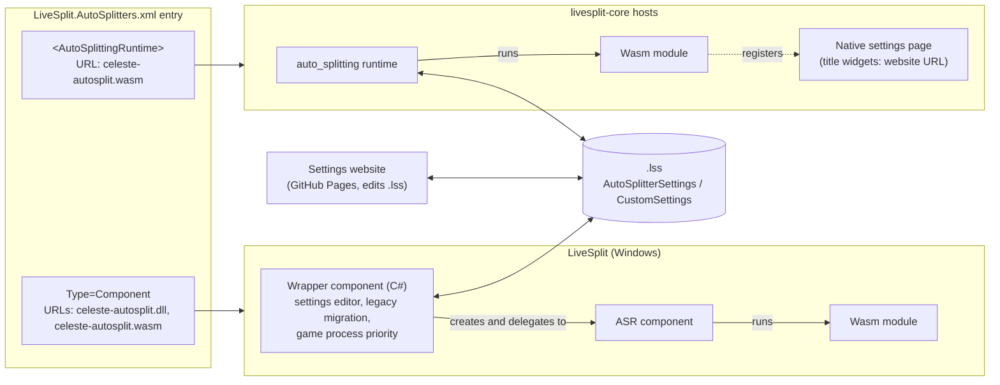

# Celeste Auto Splitter: Cross-Platform Architecture Spec

---

## 1. Summary

A single **WebAssembly auto splitter** (`celeste-autosplit.wasm`) is the only splitting engine on every host. All of its configuration lives in the **ASR settings map**. Every host already saves that map into the `.lss` splits file, so settings travel with the splits between hosts.

The native ASR settings widgets are too limited, so each host family gets its own **settings editor** that only reads and writes that map:

- **LiveSplit (Windows):** a C# component DLL (`celeste-autosplit.dll`). It wraps the wasm module, delegates all auto splitting to LiveSplit's Auto Splitting Runtime (ASR) component, and replaces the settings UI with its own control.
- **livesplit-core hosts:** a GitHub Pages website that edits the settings inside a `.lss` file. The wasm module's native settings page shows only a text pointer to that website.

A single entry in `LiveSplit.AutoSplitters.xml` serves both host families. LiveSplit desktop reads the top-level `Type=Component` part (DLL plus wasm). livesplit-core reads the nested `<AutoSplittingRuntime>` part (wasm only).

On Windows, the component also **migrates existing `LiveSplit.Celeste` settings** into the new map. Legacy settings exist only on Windows, so no other host needs a migration.

---

## 2. Goals and non-goals

**Goals**

1. One implementation of the splitting logic (the wasm module), identical on every host.
2. A rich settings editor that isn't limited by the ASR widget set (bool, title, choice, file-select).
3. Settings that move between hosts through the `.lss` file.
4. A smooth upgrade for existing `LiveSplit.Celeste` users on Windows, including their settings.
5. Distribution through the official auto splitter list, with automatic download on every host that reads it.

**Non-goals**

- Native settings editors inside livesplit-core hosts. The website covers these for now.
- Migrating legacy settings on non-Windows hosts, which have no prior standard. The website's legacy import covers runners moving old `.lss` files to other hosts (§8).
- Downgrading from the new component back to the legacy component.
- Any change to LiveSplit, livesplit-core, ASR or the list format.

---

## 3. Terminology

| Term | Meaning |
|---|---|
| **Host** | Any LiveSplit flavour that runs the wasm module. |
| **Wasm module** | `celeste-autosplit.wasm`, the Celeste auto splitter compiled to WebAssembly against the `asr` crate. |
| **Settings map** | The ASR runtime's key/value store, which supports map, list, bool, i64, f64 and string. Hosts persist it in the `.lss`. |
| **`cfg`** | The single top-level map key that holds all real settings (§5). |
| **Wrapper component** | `celeste-autosplit.dll`, the new C# component for LiveSplit desktop. |
| **ASR component** | `LiveSplit.AutoSplittingRuntime.dll`'s `ASRComponent`, which ships with LiveSplit and runs wasm modules. |
| **Legacy component** | The existing `LiveSplit.Celeste.dll` by DevilSquirrel (ShootMe). |
| **The list** | `LiveSplit.AutoSplitters.xml` in the LiveSplit/LiveSplit.AutoSplitters repo. |

---

## 4. System overview



### Responsibilities

| Concern | Wasm module | Wrapper component (Windows) | Website | Host |
|---|---|---|---|---|
| Attach to game, read memory | ✅ | | | |
| Start, split, reset, game time | ✅ | | | |
| Define the settings schema | ✅ (source of truth) | consumes it | consumes it | |
| Validate settings, apply defaults | ✅ | | | |
| Schema migrations (`schema_version`) | ✅ | | | |
| Rich settings editing | | ✅ | ✅ | |
| Native fallback UI (website pointer) | ✅ | | | renders it |
| Legacy `LiveSplit.Celeste` migration | | ✅ | legacy import | |
| Game process priority | | ✅ (§7.7) | | |
| Persist the settings map in `.lss` | | via the ASR component | writes the file directly | ✅ |
| Download and update files | | own update XML | | list, updater |

**Rule:** editors only edit data, and no splitting behaviour lives outside the wasm module. The single exception is the Windows-only game process priority (§7.7). It never affects start, split, reset or timing decisions.

---

## 5. Settings contract

### 5.1 Persistence

Every host stores the settings map in the `.lss` inside `<AutoSplitterSettings>`:

```xml
<AutoSplitterSettings>
  <Version>1.0</Version>
  <CustomSettings>
    <Setting id="schema_version" type="i64">1</Setting>
    <Setting id="cfg" type="map">
      <Setting id="auto_reset" type="bool">True</Setting>
      <Setting id="splits" type="list">
        <Setting type="map">
          <Setting id="kind" type="string" value="chapter_complete" />
          <Setting id="chapter" type="i64">1</Setting>
        </Setting>
      </Setting>
    </Setting>
  </CustomSettings>
</AutoSplitterSettings>
```

- **Who writes it:** the C# ASR component (`ComponentSettings.GetSettings`) and livesplit-core (`StoredAutoSplitterSettings`) use the same format. On Windows the wrapper creates the ASR component with a fixed script path, so no `<ScriptPath>` is written. livesplit-core hosts ignore `ScriptPath` anyway.
- **Keys without widgets survive:** both implementations save the **entire** map, not just the keys that have widgets. So data written by the editors survives a load and save on any host.
- **Serialisation rules:**
  - `bool`, `i64` and `f64` values go in the element text, using invariant culture (`True`/`False` for bools).
  - `string` values go in a `value` attribute.
  - Maps and lists nest `<Setting>` children. List items have no `id`.
- **The parser is strict:** if any element in `CustomSettings` fails to parse, the C# ASR component discards the **whole** map. Generated XML must be exact (see §13 round-trip tests).

### 5.2 Top-level keys

| Key | Type | Written by | Purpose |
|---|---|---|---|
| `schema_version` | i64 | editors; the wasm module when migrating | Version of the `cfg` layout. |
| `cfg` | map | editors | All real settings. |
| `legacy` | map | wrapper (during migration) | Verbatim copy of the old `LiveSplit.Celeste` settings, kept for re-migration and debugging. |
| `_ui_*` | — (title widget keys) | wasm module | Reserved for native fallback widgets. Title widgets hold no value. Never use for data. |

Widget keys and map keys share one namespace, which is why the `_ui_` prefix is reserved.

### 5.3 `cfg` schema

> **Illustrative only.** This sketch shows the intended shape and the fields the legacy migration needs. It is to be fleshed out into the real schema once implementation of the wasm module begins.

```text
cfg: map
  auto_reset:        bool    default true
  set_game_time:     bool    default true
  file_time_offset:  bool    default false
  high_priority:     bool    default true    (applied by the Windows component only; §7.7)
  mode:              string  "full_game" | "il"           (made explicit; see §11.4)
  splits:            list<map>
    kind:            string  e.g. "chapter_complete", "checkpoint", "heart_gem",
                             "cassette", "level_enter", "level_exit", "manual", "unknown"
    chapter:         i64     (where applicable)
    side:            string  "a" | "b" | "c"              (where applicable)
    checkpoint:      i64     (where applicable)
    room:            string  (level_enter / level_exit)
    raw:             string  (kind == "unknown": original legacy "Type,Value")
```

### 5.4 Rules

1. **Missing key means default.** The wasm module never requires a key to be present. `gui::add_bool` returns a default without writing it into the map, so the map only ever holds values someone explicitly set.
2. **Additive changes** (a new optional key with a default) don't bump `schema_version`. Renames, removals and changes of meaning do.
3. **Editors preserve unknown keys** inside `cfg`, so an older editor doesn't delete newer settings.
4. **Editors refuse newer schemas.** If `schema_version` is higher than an editor understands, it opens read-only and tells the user to update.
5. **One schema definition.** A shared schema description, for example `settings-schema.json` shipped with each release, drives both the C# editor and the website, so field lists aren't maintained three times.
6. **Writing from the wasm module** (only for schema migrations) uses `Map::store_if_unchanged` and retries on `false`, never `Map::store`.
7. **Host-specific keys** such as `high_priority` are ignored by the wasm module. The website shows them labelled "LiveSplit (Windows) only".

---

## 6. Wasm module

### 6.1 Responsibilities

Everything that affects timing:
- process attach and memory reading;
- start, split, reset and game time;
- interpreting `cfg`, applying defaults and validating values;
- migrating older `schema_version` values.

### 6.2 Native fallback UI

The module registers **title widgets only**. These are plain text, not clickable, and write nothing into the map:

```rust
use asr::settings::gui;

const URL: &str = "<owner>.github.io/<repo>";

fn register_native_ui() {
    gui::add_title("_ui_heading", "Configure this auto splitter at:", 0);
    gui::add_title("_ui_url", URL, 1);
    gui::set_tooltip("_ui_url", "Open in a browser, load your .lss, edit, save, then reload the splits.");
}
```

- On Windows these widgets are never shown, because the wrapper supplies its own settings control.
- AlexKnauth's Druid fork renders `Title`, `Bool`, `Choice` and `FileSelect` widgets, so the text appears there.
- The LiveSplit One desktop MVP has no settings UI, so nothing shows there.
- **Do not use `gui::add_text_input`.** It exists in the `asr` crate, but the C# ASR component only renders `bool`, `title`, `choice` and `file-select`.
- Keep the URL short and easy to type.

### 6.3 Reading settings

- **The module starts before its settings arrive.** On Windows the ASR component starts the runtime in its constructor with an empty map, and the real map is applied moments later by `SetSettings`. The module must therefore never read settings only once at startup.
- `Map::load()` returns a snapshot.
- Re-read the snapshot periodically (for example once a second, and on timer reset) and re-parse `cfg` only when it has changed.
- Parse defensively: wrong types or out-of-range values fall back to defaults and are logged.

### 6.4 Portability

Use only `asr` crate APIs available in every host's runtime. Assume nothing host-specific.

---

## 7. Wrapper component (LiveSplit, Windows)

### 7.1 Build and packaging

- **Project type:** .NET Framework class library targeting `net4.8.1`, the same as LiveSplit.Core and the ASR component.
- **Output names:**
  - `AssemblyName`: `celeste-autosplit`, which produces `celeste-autosplit.dll`.
  - `RootNamespace`: `CelesteAutosplit`, because hyphens aren't valid in C# namespaces.
  - **Why the assembly name matters:** it differs from the legacy `LiveSplit.Celeste` assembly, which is required. LiveSplit loads every DLL in `Components\` with `Assembly.UnsafeLoadFrom`, and two assemblies with the same identity can resolve to whichever was loaded first.
- **References:** both `LiveSplit.Core` and `LiveSplit.AutoSplittingRuntime` are compile-time references, neither copied to the output.
  - **Configuration:** `Private="false"`, plus `ExcludeAssets="runtime"` for project references. This is the same pattern the ASR project uses for LiveSplit.Core.
  - **Never ship `LiveSplit.AutoSplittingRuntime.dll`.** The copy in `Components\` belongs to LiveSplit.
  - **Source:** ASR isn't on NuGet. Reference it from a LiveSplit build or install, or add LiveSplit and LiveSplit.AutoSplittingRuntime as git submodules.
  - **Why it binds at runtime:**
    - LiveSplit loads component DLLs with `Assembly.UnsafeLoadFrom`, and .NET Framework resolves their dependencies from the folder they were loaded from.
    - The wrapper and `LiveSplit.AutoSplittingRuntime.dll` both live in `Components\`, so the reference resolves to the ASR assembly LiveSplit already loaded.
    - ASR is not strong-named, so binding is by name only, and a newer ASR shipped with LiveSplit still binds.
- **Factory attribute:** `[assembly: ComponentFactory(typeof(CelesteAutosplitFactory))]`.

### 7.2 Factory (`IComponentFactory` / `IUpdateable`)

| Member | Value |
|---|---|
| `ComponentName` | **To be decided** |
| `Category` | `Control`. The category doesn't affect visibility. LiveSplit's layout editor (`LayoutEditorDialog.LoadAllComponentsAvailable`) leaves out any component factory whose DLL is the first URL of an auto splitter list entry without `<ShowInLayoutEditor/>`. `celeste-autosplit.dll` is that first URL (§10.1), so users can't add the wrapper to a layout and it only runs as the auto splitter. |
| `Create(state)` | returns a new wrapper |
| `UpdateName`, `Version` | from the assembly version, which must match the latest version in `update.xml` (§10.4) |
| `XMLURL`, `UpdateURL` | see §10.4 |

### 7.3 Wrapper component (`LogicComponent`)

| Member | Behaviour |
|---|---|
| Constructor | Resolve `wasmPath = Path.Combine(ComponentManager.BasePath ?? "", "Components", "celeste-autosplit.wasm")`. If it's missing, enter an error state (§7.5). Otherwise create the inner component in a try/catch: `inner = new ASRComponent(state, wasmPath)`, the same constructor `ASRFactory.Create(state, script)` uses. Then run the layout check (§11.6). |
| `Update(...)` | Forward to `inner.Update(...)`. LiveSplit calls this on the active auto splitter every frame. The ASR component's `Update` is currently empty: it steps the runtime on its own timer (15 ms, adjusted to the module's tick rate), marshalled to the UI thread through `state.Form`. Forwarding keeps the wrapper correct if a future ASR does work there. Also drives the throttled priority check (§7.7). |
| `GetSettings(doc)` | `inner.GetSettings(doc)`, unchanged. This is what `XMLRunSaver` writes into the `.lss`. |
| `SetSettings(node)` | If the node is in the legacy format, migrate it (§11). Then call `inner.SetSettings(node)` and refresh the wrapper's cached `cfg.high_priority`. **Never** pass legacy XML through: the ASR component would replace the map with an empty one. |
| `GetSettingsControl(mode)` | The wrapper's own editor control. Must not be null, or LiveSplit disables the Settings button. |
| `Dispose()` | Restore the game's priority if the wrapper raised it (§7.7). Then `inner.Dispose()`, which stops its update timer and disposes the runtime. **Required.** LiveSplit calls `Dispose` on deactivation or a game change. Without forwarding it, the inner timer keeps running and the old module keeps controlling the timer. |
| `ContextMenuControls` | Optional: forward `inner.ContextMenuControls`. LiveSplit adds the active auto splitter's entries to its Control menu. ASR currently provides none. |

### 7.4 Editor control

**Data path: an XML round-trip through public API.**

1. When the editor opens, call `inner.GetSettings(doc)`, parse `CustomSettings` into the editor model, and render it from the shared schema.
2. On **every** change, serialise the model to the §5.1 format and call `inner.SetSettings(node)`.

Changes must reach `inner` straight away because of how LiveSplit's `ComponentSettingsDialog` works:
- when it opens, it snapshots `GetSettings()`;
- on **OK**, the splits editor reads `GetSettings()` again and stores the result as `Run.AutoSplitterSettings`;
- on **Cancel**, it calls `SetSettings(snapshot)` to undo.

So `GetSettings`/`SetSettings` must round-trip losslessly.

**Concurrency:** the wasm module only writes during schema migration. The editor re-reads `inner.GetSettings` each time it opens, so a migration that ran earlier is picked up.

### 7.5 Error handling

- LiveSplit reports activation failures only as a generic "could not be activated" message. The wrapper logs details itself and shows a clear status inside its editor control: wasm missing, or runtime failed to load.
- **Missing wasm:** LiveSplit checks only that the **first** URL in the list entry (the DLL) exists, so a missing wasm is never re-downloaded by LiveSplit. The wrapper either shows a repair message or downloads `celeste-autosplit.wasm` itself from `https://github.com/<owner>/<repo>/releases/latest/download/celeste-autosplit.wasm`.

### 7.6 Dependency on ASR internals

The wrapper depends on two things owned by `LiveSplit.AutoSplittingRuntime`, neither of which is a stable API:
- the `ASRComponent(state, scriptPath)` constructor and any other ASR types it uses;
- the `CustomSettings` XML format.

**Keep ASR types out of the factory.** `CelesteAutosplitFactory` must not use ASR types in its fields, properties or method signatures. LiveSplit creates factories inside `ComponentManager.LoadFactory`, which swallows every exception with `catch { }`. If creating the factory pulls in ASR types and that fails, the factory silently becomes `null` and users see only "could not be activated". Use ASR types only inside the wrapper component.

**Handle failures clearly.** Create the ASR component in a try/catch that reports a clear error (§7.5). If a future ASR removes or changes a member the wrapper uses, the call fails at runtime with `MissingMethodException` or `TypeLoadException`. The compile-time reference only protects against mismatches with the ASR version you build with.

**Track the tested version.**
- Build against the ASR version current LiveSplit ships (0.0.12 at time of writing) and record it in release notes.
- Re-test whenever LiveSplit ships a new ASR.

### 7.7 Windows-only: game process priority

The legacy component's `SetHighPriority` setting sets the **Celeste game process's** priority class: `High` when on, `Normal` when off, applied once hooked. It does not change LiveSplit's own priority. A wasm module can't change process priority, so the wrapper takes this over.

- **Setting:** `cfg.high_priority`. Default `true`, matching the legacy default. Migrated from `<SetHighPriority>` (§11.4). The wrapper keeps a cached value, refreshed on every `SetSettings` and editor change.
- **Detection:**
  - At most every 2 seconds, driven from `Update`, look up `Process.GetProcessesByName("Celeste")`, the same name the legacy component uses.
  - Track the process ID so the priority is applied once per process, and again only when the setting changes.
- **Apply:**
  - Set `PriorityClass` to `High` when the setting is on.
  - Set it back to `Normal` when the setting is turned off while the game is running, but only if the wrapper had raised it.
  - On `Dispose`, restore `Normal` if the wrapper had raised it.
- **Robustness:**
  - Catch `Win32Exception`, `InvalidOperationException` and access-denied errors (for example if the game exited or runs elevated), and log them.
  - Dispose `Process` objects after use.
  - Never block the UI thread on this.
- **Scope:** affects only performance, never splitting decisions, so it's consistent with the rule in §4.

---

## 8. Settings website

- **Hosting:** GitHub Pages from `<owner>/<repo>` at `https://<owner>.github.io/<repo>/`. It's static: settings are edited on the user's own machine and the `.lss` is never uploaded.
- **Workflow:**
  1. Open `.lss`.
  2. Parse the XML.
  3. Locate `<AutoSplitterSettings>/<CustomSettings>`.
  4. Render the editor from the shared schema.
  5. Write the map back, then download the `.lss`.
- **File preservation:** replace **only** the `<AutoSplitterSettings>` element and keep the rest of the file intact.
- **Output format:** must produce exactly the §5.1 format and set `schema_version`. Apply the same §5.4 rules: preserve unknown keys, refuse newer schemas, and label Windows-only settings.
- **User guidance:** close the splits in the host before editing (or don't save from the host afterwards), otherwise the host overwrites the edit.
- **Legacy import:** detect the legacy `LiveSplit.Celeste` format (§11.1) and convert it with the same mapping table as the wrapper. This is for runners carrying old Windows `.lss` files to other hosts, because livesplit-core reads only `CustomSettings`.
- **Downloads for other hosts:** link to `celeste-autosplit.wasm` on the latest release, with setup steps for hosts that don't read the list (§9).
- **Discovery:** the URL appears in the native fallback widgets (§6.2). It is also the list entry's nested `<Website>`, and the nested `<Description>` tells users to "Configure at the linked website." (§10.1). Whether livesplit-core hosts show that website link is up to each host's UI.

---

## 9. livesplit-core hosts

| Host | How it finds the wasm | Settings UI | Saves map to `.lss` |
|---|---|---|---|
| **CryZe's new LiveSplit One desktop** (private, not Druid-based) | The list, via `livesplit_core::auto_splitting::list`. Uses the nested `<AutoSplittingRuntime>` URL and ignores non-wasm entries. | Unknown | Expected (livesplit-core) |
| **AlexKnauth/livesplit-one-druid** | User-chosen path: config file, `--autosplitter`, or the "Open Auto Splitter" menu. Doesn't read the list. | Renders Title, Bool, Choice and FileSelect | Yes (`run_auto_splitter_settings_map_store` on save) |
| **CryZe/livesplit-one-desktop (MVP, last commit 2023)** | Config file path. Doesn't read the list. | None | Unverified |
| **CryZe/livesplit-one-druid** | Config file path. Doesn't read the list. | — | Unverified |

Hosts that don't read the list need a direct `.wasm` download link and short setup instructions on the website (§8).

---

## 10. Distribution

### 10.1 List entry

This replaces the existing Celeste entry. The game names are the current ones.

```xml
<AutoSplitter>
    <Games>
        <Game>Celeste</Game>
        <Game>Quickie Mountain 2</Game>
        <Game>Celeste Category Extensions</Game>
        <Game>Modded Celeste</Game>
        <Game>Monika's D-Sides</Game>
        <Game>2020 Spring Collab</Game>
        <Game>Glyph Pack</Game>
        <Game>Into The Jungle</Game>
        <Game>Strawberry Jam Collab</Game>
        <Game>Archie Collab</Game>
        <Game>Gallery Collab 2024</Game>
        <Game>Startup Contest 2021</Game>
    </Games>
    <URLs>
        <URL>https://github.com/<owner>/<repo>/releases/latest/download/celeste-autosplit.dll</URL>
        <URL>https://github.com/<owner>/<repo>/releases/latest/download/celeste-autosplit.wasm</URL>
    </URLs>
    <Type>Component</Type>
    <Description>Autosplitting is available.</Description>
    <Website>https://github.com/<owner>/<repo></Website>
    <AutoSplittingRuntime>
        <URL>https://github.com/<owner>/<repo>/releases/latest/download/celeste-autosplit.wasm</URL>
        <Description>Autosplitting is available. Configure at the linked website.</Description>
        <Website>https://<owner>.github.io/<repo>/</Website>
    </AutoSplittingRuntime>
</AutoSplitter>
```

The Hollow Knight and Path of Exile 2 entries already use this exact shape: a `Type=Component` DLL plus a nested `<AutoSplittingRuntime>` wasm. Many existing entries also use `releases/latest/download/` URLs, which LiveSplit's downloader follows through GitHub's redirect. The list repo's CI runs LiveSplit's test suite against the XML.

### 10.2 How each side reads it

| Reader | Reads | Ignores |
|---|---|---|
| LiveSplit `AutoSplitterFactory` | Direct children only: `Type`, `URLs`, `Description`, `Website` | Nested `<AutoSplittingRuntime>` |
| livesplit-core `List::get_for_game` | If `<AutoSplittingRuntime>` is present: its single `URL`, plus `Description`/`Website` overrides; marks the entry as using ASR | Top-level URLs (cleared) |

### 10.3 Constraints

- **The DLL must be the first URL.** LiveSplit derives the file name from it and only downloads when that file is missing.
- **The nested runtime element holds exactly one URL** (if there are several, the last wins), so the wasm module must be self-contained.
- **Game names:** livesplit-core matches exactly, case included, and takes the first match. LiveSplit desktop matches case-insensitively. Keep every name variant in `<Games>`.
- **Both URLs point at the same wasm release asset**, so the two host families run the same build.
- **Asset names never change** between releases, so `latest/download/<name>` always resolves.

### 10.4 Updates

**Windows**

At startup LiveSplit checks the `XMLURL` of every loaded component factory. If a newer version is listed, it runs `UpdateManager`. For each file entry, the updater downloads `UpdateURL + path` and saves it to `localPath`, which falls back to `path` if not given.

| Factory member | Value |
|---|---|
| `XMLURL` | `https://raw.githubusercontent.com/<owner>/<repo>/main/update.xml` |
| `UpdateURL` | `https://github.com/<owner>/<repo>/releases/` |

`update.xml`, newest first:

```xml
<updates>
  <update version="1.0.1">
    <files>
      <file path="latest/download/celeste-autosplit.dll"  localPath="Components/celeste-autosplit.dll"  status="changed"/>
      <file path="latest/download/celeste-autosplit.wasm" localPath="Components/celeste-autosplit.wasm" status="changed"/>
    </files>
    <changelog>
      <change>…</change>
    </changelog>
  </update>
</updates>
```

Rules:
- **Use the same `path` in every version entry.** The updater gathers file changes from every newer version into a dictionary keyed by `path`. Identical `latest/download/...` paths collapse into a single download of the latest release. Version-tagged paths (`download/v1.0.1/...`) would download several versions onto the same local file in an unspecified order.
- **Keep the assembly version and `update.xml` in sync.** The DLL's assembly version must equal the newest `version` in `update.xml`. Otherwise LiveSplit offers the same update on every start.
- **Commit after publishing.** Commit `update.xml` to `main` only **after** the release assets are published, so it never advertises files that aren't live yet.
- **Release both files together.** Always release the DLL and the wasm together.

**livesplit-core hosts:** livesplit-core only parses the list and downloads files. Caching and re-downloading belong to each host app.

---

## 11. Migration from `LiveSplit.Celeste`

### 11.1 Legacy format

The legacy component (v1.4.6) saves flat children under `<AutoSplitterSettings>`:

```xml
<AutoSplitterSettings>
  <AutoReset>True</AutoReset>
  <SetHighPriority>True</SetHighPriority>
  <SetGameTime>True</SetGameTime>
  <FileTimeOffset>False</FileTimeOffset>
  <Splits>
    <Split>Prologue</Split>
    <Split>Chapter1Checkpoint1</Split>
    <Split>LevelEnter,a-02</Split>
  </Splits>
</AutoSplitterSettings>
```

Each `<Split>` is `Type[,Value]`, where `Type` is a `SplitType` enum name (about 70 values) and `Value` is optional (for example a room name).

### 11.2 Rollout path: new file name

- **Fresh installs and existing users alike:** the list entry's first URL becomes `celeste-autosplit.dll`. Existing users don't have that file, so their next activation downloads `celeste-autosplit.dll` and `celeste-autosplit.wasm`. That activation happens automatically when they load Celeste splits, because LiveSplit remembers activation by game name.
- **The old DLL:** `LiveSplit.Celeste.dll` stays in users' `Components\`. LiveSplit still loads its factory at startup, which is harmless. It only matters if the legacy component is in a layout (§11.6).
- **Rejected alternative:** pushing the new files through the legacy component's update channel (`ShootMe/LiveSplit.Celeste/Components/Updates.xml`). It would need push access to that repo and only reaches users with update checks enabled.
- **Keeping the old file name would not work.** LiveSplit would see `LiveSplit.Celeste.dll` already present, never download the new files, and keep loading the legacy component.

### 11.3 Detection

In `SetSettings`, the node is legacy when `CustomSettings` is absent **and** `Splits` or `AutoReset` is present. Nodes that are empty or have no recognisable children are passed through unchanged.

### 11.4 Mapping rules

1. **Use the legacy defaults for absent elements.** When an element was missing, the legacy component treated `AutoReset`, `SetHighPriority` and `SetGameTime` as `true` and `FileTimeOffset` as `false`. Apply those, not the new defaults.
2. **Make inferred behaviour explicit.** The legacy component derives `ILSplits` and `ChapterSplits` from split counts: it's an IL setup if there are no splits, or at most one each of chapter, heart, area and cassette splits. Compute this during migration and store it as `cfg.mode` so the wasm module doesn't have to copy the heuristic.
3. **Split types:** a table maps every `SplitType` to a `cfg.splits` entry, carrying `Value` where it applies (room names for `LevelEnter` and `LevelExit`). A table-driven test enforces full coverage. The final table depends on the real `cfg` schema.
4. **Unknown or unparseable splits** become `{kind: "unknown", raw: "<original>"}`. The editor flags these for the user to fix, and nothing is dropped.
5. **`SetHighPriority`** maps to `cfg.high_priority`, applied by the wrapper on Windows (§7.7).
6. **Keep the original:** write the original values into `legacy` (bools, plus a list of raw split strings) for re-migration if a mapping bug is found.
7. **Output:** `<Version>1.0</Version><CustomSettings>…</CustomSettings>` with `schema_version` set, in the exact §5.1 format.

### 11.5 Persistence

The migrated settings reach disk only when the user saves the splits for another reason. The wrapper does **not** set `Run.HasChanged`. Until a save happens, the migration re-runs on each load from the unchanged legacy XML and gives the same result each time. Migration must therefore stay pure and deterministic.

### 11.6 Users with the legacy component in their layout

The legacy factory registers as a `Control` component, so some runners have it in their `.lsl` layout. For them, settings live in the layout file, and once the wrapper activates both components would run.

The legacy component becomes **more** visible after the switch. While `LiveSplit.Celeste.dll` was the Celeste entry's first URL, the layout editor hid it (§7.2). Once the entry points at `celeste-autosplit.dll`, the old DLL still in users' `Components\` is no longer tied to any list entry, so the layout editor lists it. That makes it easier to add by mistake.

When the wrapper is created, it scans `state.Layout.LayoutComponents` for path `LiveSplit.Celeste.dll`. If it finds one, it:
- warns the user to remove it, to avoid double splits;
- offers to import its settings (`GetSettings` from that component, passed through the same migration) if the `.lss` holds none.

### 11.7 Downgrade

Not supported. The legacy component reads flat elements, which the new format doesn't contain. A runner who reinstalls the legacy component has to set up its splits again. Release notes should say so.

---

## 12. Risks and open items

| # | Item | Notes and mitigation |
|---|---|---|
| 1 | Component display name | To be decided. |
| 2 | Real `cfg` schema and split mapping table | To be fleshed out once implementation begins. |
| 3 | Changes to the ASR component's API | `ASRComponent` constructor, XML format. Mitigated by §7.6. |
| 4 | Druid fork and MVP persistence | MVP map persistence is unverified. |
| 5 | Double splitting | Legacy component in layout (§11.6). The wrapper itself is hidden from the layout editor (§7.2). |
| 6 | Assembly identity collision | Addressed by assembly name `celeste-autosplit` (§7.1). |
| 7 | Strict `CustomSettings` parsing | A single bad element wipes the map. Covered by round-trip tests (§13). |
| 8 | Legacy "Auto add enter/exit splits" | The legacy component adds two Control-menu entries that record room transitions while playing and append `LevelEnter`/`LevelExit` splits. This isn't covered yet. A possible port: the wasm publishes the current room as a custom variable via `asr::timer::set_variable`, which LiveSplit stores in the run's custom variables, and the wrapper's `ContextMenuControls` watches it and appends splits to `cfg`. Decide whether to port it. |
| 9 | Other legacy Windows-only behaviour | Priority is handled (§7.7). Finish auditing the legacy component for anything else. |

---

## 13. Test plan

**Unit**
- **Migration corpus:** real community `.lss` files (full game, ILs, Category Extensions, collabs, `LevelEnter` room splits) run through `Migrate`. Snapshot the output and check it by hand.
- **Repeatability:** migrating the same legacy XML twice gives byte-identical output.
- **`SplitType` coverage:** a table-driven test fails if any enum value has no mapping.
- **Round-trip:** wrapper serialiser, then ASR's parser, then ASR's writer, gives identical XML. The same XML parses with livesplit-core's `StoredAutoSplitterSettings`.
- **Wasm module:** missing keys, wrong types, newer `schema_version`, empty map.

**Integration (Windows)**

Build LiveSplit from source with `AutoSplitterFactory.AutoSplittersXmlUrl` pointed at a test copy of the list. Test these scenarios:
1. Fresh install: download, activate, edit, save, reload.
2. Existing legacy user (with `LiveSplit.Celeste.dll` installed and a legacy `.lss`): new files download, migration runs, save, reload.
3. Legacy component in layout: warning, and an offer to import its settings.
4. Layout editor: `celeste-autosplit.dll` is not offered once the list is loaded, and `LiveSplit.Celeste.dll` is.
5. Update via `update.xml`: both files replaced; no repeated update prompt afterwards.
6. Wasm deleted: clear error or self-repair.
7. Settings dialog Cancel: changes reverted.
8. Game priority: High applied when the game starts with the setting on; Normal restored when toggled off and on deactivation; no errors when the game exits.

**Cross-host**
- A `.lss` saved on Windows opens in the Druid fork and CryZe's app with identical settings.
- A `.lss` edited on the website opens on Windows with identical settings.
- The Druid fork shows the native fallback widgets.
